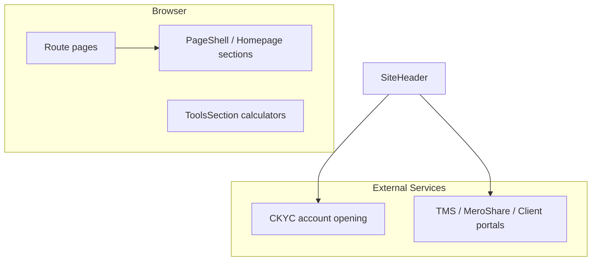

# Imperial Securities — Corporate Website

Public marketing and client-information website for **Imperial Securities**, a SEBON-licensed Nepalese stock brokerage (Broker No. 45) operating on NEPSE since 1997. The site covers company information, services, investor tools, and branch locations.

## Tech Stack

| Layer | Technology |
|-------|------------|
| Framework | [TanStack Start](https://tanstack.com/start) (React 19 + SSR) |
| Routing | [TanStack Router](https://tanstack.com/router) (file-based routes) |
| Styling | Tailwind CSS v4, custom brand tokens |
| UI primitives | [shadcn/ui](https://ui.shadcn.com) (Radix UI + CVA) |
| Animation | Framer Motion |
| Forms / validation | React Hook Form, Zod |
| Build tool | Vite 7 |
| Runtime | Node.js (Nitro `node-server`) |
| Database | PostgreSQL 16 (Docker Compose) |
| Deployment target | VPC / Docker (`docker compose`) |

The app uses TanStack Start with Vite, Tailwind CSS v4, Nitro for Node SSR, and Postgres for the CMS store.

## Getting Started

### Prerequisites

- Node.js 20+ (or Bun — `bunfig.toml` is present)
- npm, pnpm, or bun

### Install & run

```bash
cp .env.example .env
npm install
npm run db:up      # start Postgres via Docker Compose
npm run dev        # local Vite + Node SSR on :8080
npm run build      # production build → .output/
npm run start      # node .output/server/index.mjs
npm run lint
```

### Full stack with Docker

```bash
docker compose up --build
# site → http://localhost:8080
# admin → http://localhost:8080/admin/login  (admin / imperial-local by default)
```

## Project Structure

```
src/
├── routes/              # File-based pages (TanStack Router)
│   ├── __root.tsx       # HTML shell and global meta
│   ├── index.tsx        # Homepage (section composition)
│   ├── services.*.tsx   # Service detail pages
│   └── branches.$slug.tsx  # Dynamic branch detail pages
├── components/
│   ├── ui/              # shadcn/ui components (40+)
│   ├── PageShell.tsx    # Standard layout: TopBar + Header + Footer
│   ├── SiteHeader.tsx   # Navigation, login/account dropdowns
│   └── ToolsSection.tsx # Interactive investor calculators
├── hooks/
├── lib/utils.ts         # cn() helper (clsx + tailwind-merge)
├── assets/              # Logos, images
├── styles.css           # Tailwind + brand design tokens
└── router.tsx           # Router factory + error boundary
```

Path alias: `@/*` → `./src/*` (see `tsconfig.json`).

## Architecture



### Routing

Routes are auto-generated in `src/routeTree.gen.ts` from files in `src/routes/`. Do not edit the generated file manually.

- **Dot notation** = path segments: `services.stock-brokerage.tsx` → `/services/stock-brokerage`
- **Dollar prefix** = dynamic param: `branches.$slug.tsx` → `/branches/:slug`

Each route exports a `Route` object via `createFileRoute()` with optional `head()` for per-page SEO meta tags.

### Layout patterns

1. **Homepage** (`/`): Composes standalone section components directly (TopBar, SiteHeader, LiveTicker, Hero, Services, Tools, etc.) — no `PageShell`.
2. **Inner pages**: Wrap content in `PageShell` (TopBar + SiteHeader + children + SiteFooter) and usually lead with `PageHero` (title, subtitle, breadcrumbs).

### Design system

Brand colors and fonts are defined in `src/styles.css`:

- **Fonts**: Syne (headings), DM Sans (body)
- **Brand palette**: `--brand-blue`, `--brand-green`, and light/dark variants
- **UI tokens**: shadcn-style CSS variables (`--background`, `--primary`, etc.)

## Pages & Routes

### Core

| Route | Description |
|-------|-------------|
| `/` | Homepage with hero, services, tools, branches, CTA |
| `/about` | Company overview and leadership |
| `/chairman-message` | Chairman's message |
| `/management-team` | Management team |
| `/our-team` | Staff directory |
| `/contact` | Contact form and details |
| `/support` | Client support |
| `/faqs` | Frequently asked questions |
| `/grievance` | SEBON-compliant grievance submission form |
| `/downloads` | Document downloads |
| `/blog` | Blog listing |
| `/news-events` | News and events |

### Services

| Route | Topic |
|-------|-------|
| `/services/stock-brokerage` | Equity trading on NEPSE |
| `/services/depository-services` | DEMAT / depository participant |
| `/services/margin-trading` | Margin trading facility |
| `/services/portfolio-management` | Portfolio management |
| `/services/ipo-fpo` | IPO/FPO applications |
| `/services/research-advisory` | Research and advisory |

### Branches

| Route | Branch |
|-------|--------|
| `/branches/kathmandu` | Head office |
| `/branches/nepalgunj` | Nepalgunj |
| `/branches/surkhet` | Surkhet |
| `/branches/bhaktapur` | Bhaktapur |
| `/branches/dhading` | Dhading |
| `/branches/pokhara` | Pokhara |

Branch list data lives in `BranchesSection.tsx`; extended detail in `branches.$slug.tsx`.

## Key Features

### Navigation (`SiteHeader.tsx`)

- Multi-level dropdown menus: Resources, Services, Market, Tools
- **Login** dropdown: Client Login, MeroShare, TMS (external links)
- **Open Account** dropdown: TMS/Broker, DEMAT, or both via CKYC portals
- Mobile accordion menu with the same structure
- Tools menu deep-links to homepage calculators via `window.__imperialOpenTool` or sessionStorage

### Investor tools (`ToolsSection.tsx`)

Client-side calculators (no backend):

- Share Calculator (buy/sell P&L with charges)
- WACC Calculator
- Bonus Adjustment Calculator
- Rights Adjustment Calculator
- Dividend Calculator
- IPO Allotment Check (links to CDSC external site)

### Live ticker (`LiveTicker.tsx`)

Animated scrolling ticker on the homepage. **Currently uses static mock data**, not live NEPSE feeds.

## External Integrations

| Service | URL | Used for |
|---------|-----|----------|
| Nepse Alpha | nepsealpha.com | Live market iframes |
| CKYC (Imperial) | ckyc.imperialsecurities.com.np | Broker account opening |
| CKYC (CDSC) | ckyc.cdsc.com.np | DEMAT registration |
| Client portal | client45.cmt.com.np | Client login |
| TMS | tms45.nepsetms.com.np | Trading terminal |
| MeroShare | meroshare.cdsc.com.np | IPO / share management |
| IPO results | iporesult.cdsc.com.np | Allotment check |

## Deployment

Configured for **Node.js + PostgreSQL** via Nitro and Docker Compose.

```bash
# Local Postgres only (app runs with npm run dev / npm run start)
npm run db:up

# Full stack (app + Postgres)
docker compose up --build -d
```

Production env vars: `DATABASE_URL`, `ADMIN_USERNAME`, `ADMIN_PASSWORD`, `SESSION_SECRET`, `PORT`.

## Known Limitations & TODOs

- **Homepage sections disabled**: `DownloadSection` and `NewsSection` are commented out in `index.tsx`.
- **Mock ticker data**: `LiveTicker` does not fetch real NEPSE prices.
- **Forms are client-only**: Grievance and contact forms simulate submission in the browser; no backend persistence or email integration yet.
- **TopBar PDF link**: Margin trading guidelines link uses a Windows-style path (`src\assets\pdf\...`) that may not resolve correctly in production.

## Scripts Reference

| Command | Action |
|---------|--------|
| `npm run dev` | Start Vite + Node SSR |
| `npm run build` | Production build (`.output/`) |
| `npm run start` | Run production Node server |
| `npm run build:dev` | Development-mode build |
| `npm run preview` | Preview built output |
| `npm run lint` | Run ESLint |
| `npm run db:up` | Start Postgres (`docker compose`) |
| `npm run db:down` | Stop Compose services |
| `npm run docker:up` | Build and run app + Postgres |
| `npm run docker:down` | Stop Compose stack |

## License

Private repository — all rights reserved.
